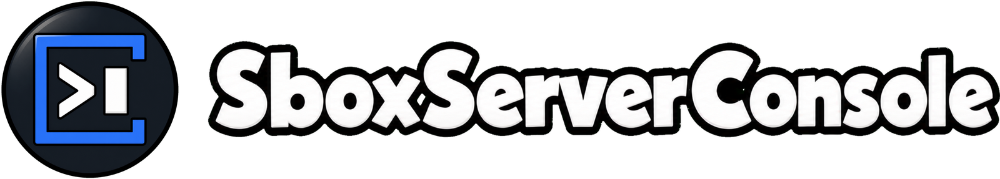
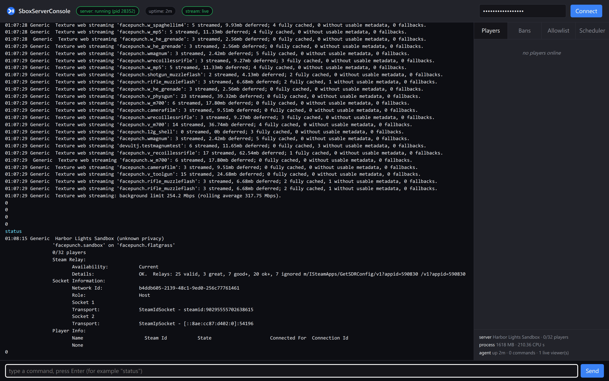
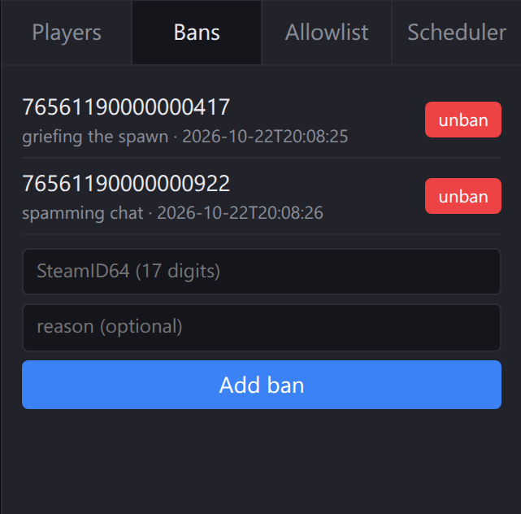
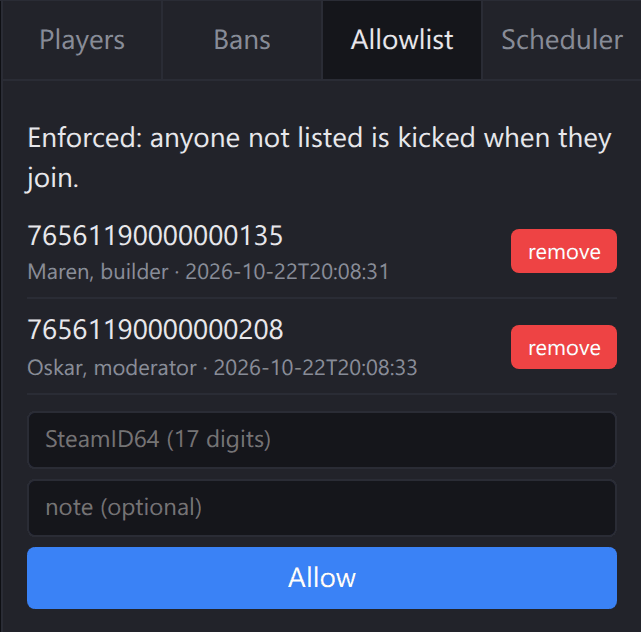
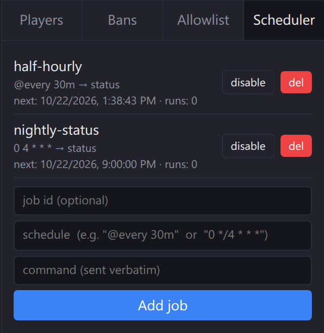
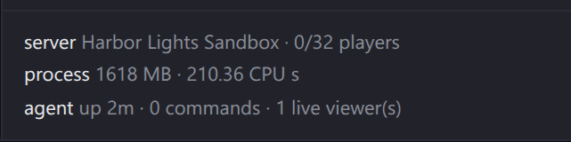

<p align="center">
  
</p>

# SboxServerConsole

[](LICENSE)
[](https://dotnet.microsoft.com/)
[](#install)
[](https://developer.valvesoftware.com/wiki/Source_RCON_Protocol)
[](https://store.steampowered.com/app/590830/)

Everything your s&box dedicated server is missing: Source RCON, a live web console, bans and an allowlist that kick on join, scheduled commands, crash restarts, an audit log and Discord notifications. It is one file that runs next to the server on Windows or Linux, and it needs no changes to s&box or to your game.

_SboxServerConsole is a community project and is not affiliated with or endorsed by Facepunch Studios._

> **[Rent an s&box server](https://www.survivalservers.com/services/game_servers/sbox/?utm_source=github&utm_medium=readme&utm_campaign=sbox_server_console)**. Survival Servers game servers come with SboxServerConsole already installed.

---

## Table of Contents

- [Features](#features)
- [Install](#install)
- [Using SboxServerConsole](#using-sboxserverconsole)
- [Ports and security](#ports-and-security)
- [Trust and first run](#trust-and-first-run)
- [Getting help](#getting-help)
- [Contributing](#contributing)
- [License](#license)

---

## Features

### 🖥️ Live web console

Open the dashboard in a browser and you get the server's console as it happens, a command line, the online players with kick and ban buttons, bans, the allowlist, scheduled commands and the server's memory, CPU and player count. It is a single page built into the program, with no extra files and no internet access needed.

<p align="center">
  
</p>

### 🚫 Bans and allowlist, enforced on join

The agent watches the server's own join lines and kicks a banned SteamID the moment it connects. Fill the allowlist and only the players on it can join; leave it empty and the server is open. Adding the first entry does not kick players who are already on, so kick them from the Players tab if they should go. Both lists are plain JSON files that survive restarts, and a file that cannot be read is set aside rather than overwritten.

A dedicated s&box server ignores `+maxplayers`, so the agent can keep a player limit instead: set `max-players` and a player who joins when that many are already on is kicked with the reason "Server is full."

<p align="center">
  
  
</p>

### ⏰ Scheduled commands

Run any console command on a timer (`@every 30m`) or on a cron schedule (`0 4 * * *`, in UTC). Jobs are saved to disk and keep running across restarts.

<p align="center">
  
</p>

### 📊 Server status

The agent asks the server for its name, player count and player list over the standard A2S query, reads the server process's memory and CPU time, and keeps its own roster of who joined with their SteamIDs. If A2S reports players but no join line has ever matched, it says so, because then bans cannot see joins either.

<p align="center">
  
</p>

### Also built in

- **Source RCON:** the s&box dedicated server has no RCON. SboxServerConsole adds a standard Source RCON port, so any Source RCON client, such as [mcrcon](https://github.com/Tiiffi/mcrcon) or [rcon-cli](https://github.com/itzg/rcon-cli), can run console commands and read the replies.
- **Crash restarts:** if the server exits on its own, the agent starts it again after a short wait, up to a limit inside a time window so a server that crashes on boot does not loop forever. When it gives up, it exits with code 4 so systemd or a Windows service can take over. Restarts you ask for never count against that limit.
- **Audit log and Discord:** every command, RCON login, ban change, scheduled run and restart goes into an append-only JSON-lines audit log that rotates at 10 MB. Point it at a Discord webhook and joins, leaves, starts and crashes are posted to your channel.
- **HTTP API:** everything the dashboard does is a plain HTTP call with JSON in and out, including a live Server-Sent Events console feed that picks up where it left off after a reconnect. The full reference is in [`docs/api.md`](docs/api.md).

---

## Install

You need an s&box dedicated server. Install it with [SteamCMD](https://developer.valvesoftware.com/wiki/SteamCMD) (app `1892930`, no Steam login needed):

```bash
# Windows
steamcmd +force_install_dir "C:\sbox-server" +login anonymous +app_update 1892930 validate +quit

# Linux
./steamcmd.sh +force_install_dir /opt/sbox-server +login anonymous +app_update 1892930 validate +quit
```

The server's command line goes in `child-args`. SboxServerConsole splits it into arguments itself: double quotes group words (`+hostname "My Server"`) and every other character reaches the server as written. The flags SboxServerConsole reads are `+port` (game port) and `+net_query_port` (A2S port; the server uses 27016 when it is left out). `+game <package> [map]` picks what to run, and `+net_game_server_token <token>` gives the server a fixed SteamID ([register one](https://steamcommunity.com/dev/managegameservers) with app ID `1892930`). Facepunch's [dedicated server guide](https://sbox.game/dev/doc/networking/dedicated-servers) lists the rest.

### Windows (x64)

1. Download `SboxServerConsole.exe` from the [latest release](https://github.com/HumanGenome/SboxServerConsole/releases/latest) and put it next to `sbox-server.exe`.
2. Copy [`examples/config.example.json`](examples/config.example.json) to `config.json` and set the paths and a strong `rcon-password`.
3. Run it:

   ```powershell
   .\SboxServerConsole.exe --config-file .\config.json
   ```

4. Optional: install it as a Windows service with automatic restart (run as Administrator):

   ```powershell
   .\scripts\install-service.ps1 -ExePath .\SboxServerConsole.exe -ConfigPath .\config.json
   Start-Service SboxServerConsole
   ```

   `SboxServerConsole-win-x64.zip` on the release page carries the scripts and examples alongside the exe.

### Linux (x64)

1. Download and unpack the release next to the server:

   ```bash
   cd /opt/sbox-server
   curl -L -o sboxconsole.tar.gz https://github.com/HumanGenome/SboxServerConsole/releases/latest/download/SboxServerConsole-linux-x64.tar.gz
   tar -xzf sboxconsole.tar.gz
   ```

2. Copy [`examples/config.linux.example.json`](examples/config.linux.example.json) to `sboxconsole.json` and set the paths and a strong `rcon-password`. `exe` points at the server's own `sbox-server` program.
3. Run it:

   ```bash
   ./SboxServerConsole --config-file ./sboxconsole.json
   ```

4. Optional: run it under systemd with the example unit. Edit `User=`, `ExecStart=`, `WorkingDirectory=` and `ReadWritePaths=` first.

   ```bash
   sudo install -d /var/log/sboxconsole /var/lib/sboxconsole
   sudo cp examples/sboxserverconsole.service /etc/systemd/system/
   sudo systemctl daemon-reload
   sudo systemctl enable --now sboxserverconsole
   ```

On Linux the server runs on a pseudo-terminal that SboxServerConsole holds, because the s&box server only reads console commands when its output is a terminal. Releases before 1.4.0 used plain pipes, and on current s&box builds their commands, kicks and bans never reach a Linux server. Update if you run 1.3.x on Linux.

### Configuration

Every `--flag` also works as a key in the JSON config file; flags on the command line win. Run `SboxServerConsole --help` for the full list. The agent warns at startup about any setting it does not recognise, so a misspelled key does not go unnoticed.

---

## Using SboxServerConsole

- **Dashboard:** open `http://127.0.0.1:<listen-port>/` (the game port + 4 by default) and enter the RCON password. Use `127.0.0.1`, not `localhost`: the listener only answers the address it was bound to.
- **RCON:** connect any Source RCON client to the game port + 5, for example `mcrcon -H your-host -P 27020 -p YourPassword "status"`.
- **Terminal:** when you start the agent in a terminal, the same window shows the server's console and takes commands.
- **Scripts:** see [`examples/curl.sh`](examples/curl.sh) for a curl tour and [`examples/python_client.py`](examples/python_client.py) for a small Python client.

```bash
# Run a command and get its output
curl -X POST "http://127.0.0.1:27019/execute?collect=1" \
  -H "X-RCON-Password: YourPassword" -d '{"cmd":"status"}'
```

Lifecycle calls (`POST /server/start`, `/server/stop`, `/server/restart`) control the game server while the agent keeps running. They take no body, but on Windows send `Content-Length: 0` or a `{}` body anyway: Windows answers `411 Length Required` to an empty POST without one before the request reaches the agent. Chat broadcast (`POST /chat`) uses the game's `say` command, which many games do not have, including the stock `facepunch.sandbox`; the API answers `422` on those rather than pretending the message went out.

---

## Ports and security

| Port (defaults for game port 27015) | Protocol | What |
|---|---|---|
| 27015 | UDP | Game traffic (`+port`) |
| 27016 | UDP | A2S query (`+net_query_port`, or 27016 when not set) |
| 27019 | TCP | HTTP API, dashboard and live console (game port + 4) |
| 27020 | TCP | Source RCON (game port + 5) |

- Both listeners bind `127.0.0.1` by default. To reach them from elsewhere, set `--bind 0.0.0.0` and open the firewall; the agent does not do TLS, so put a reverse proxy in front for that. Have the proxy send `127.0.0.1:<port>` as the Host header (nginx does by default; in Caddy use `header_up Host {upstream_hostport}`).
- One password, `--rcon-password`, protects the HTTP API and RCON. Without one, the API answers `503` and RCON stays off.
- After 10 wrong passwords in a minute, that address is refused for 5 minutes on both listeners. Local connections are never locked out.
- Commands with line breaks or control characters are refused, and the log browser never serves hidden files or dot-files, which keeps the agent's own config out of reach.

Report security problems privately, as described in [SECURITY.md](.github/SECURITY.md).

---

## Trust and first run

The Windows release is not code-signed, so Windows may warn on first run. In SmartScreen choose **More info**, then **Run anyway**. If you downloaded the zip in a browser, unblock the file first (`Unblock-File .\SboxServerConsole.exe`). If your policy forbids unsigned programs, build it yourself:

```bash
dotnet publish src/SboxServerConsole.csproj -c Release -r win-x64 --self-contained -p:PublishSingleFile=true -o publish/win-x64
```

Builds are deterministic on one machine with one .NET SDK, but a local build will not match the release file byte for byte; check downloads against `SHA256SUMS` on the release page instead.

---

## Getting help

- **Bugs and feature requests:** [GitHub issues](https://github.com/HumanGenome/SboxServerConsole/issues). Include your SboxServerConsole version (`GET /version`), the server build (first line of `.version` in the server folder) and the agent's console output.
- **Problems with the s&box server itself:** [Facepunch's issue tracker](https://github.com/Facepunch/sbox-public/issues).
- **A hosted server:** ask your hosting provider.

## Contributing

Pull requests are welcome. [CONTRIBUTING.md](CONTRIBUTING.md) has the build and test commands.

## License

MIT, see [LICENSE](LICENSE).
