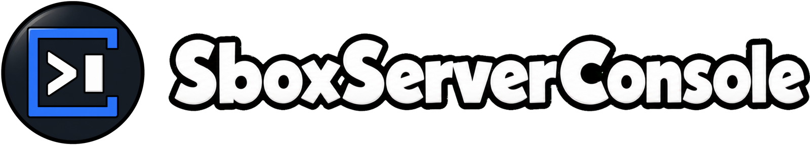
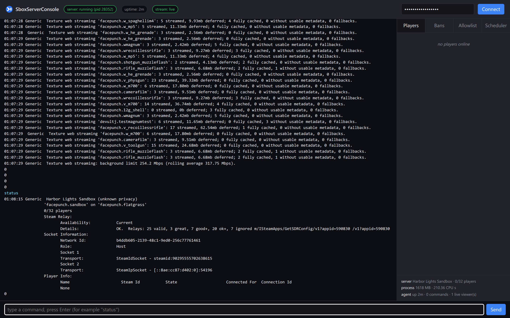
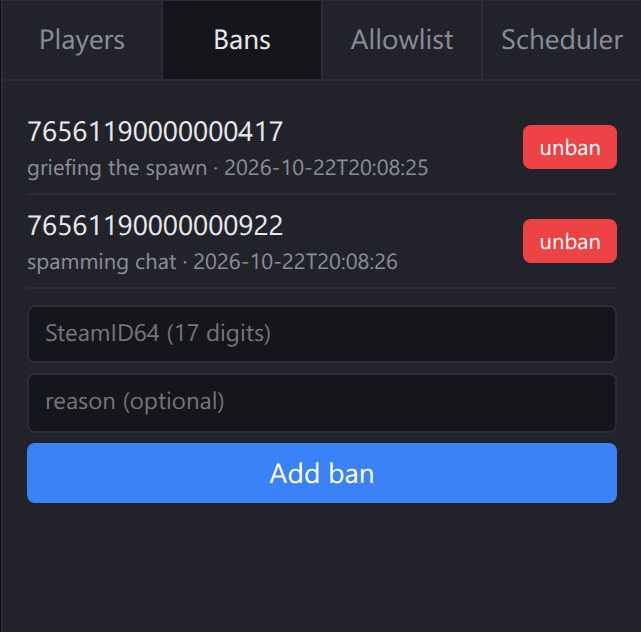
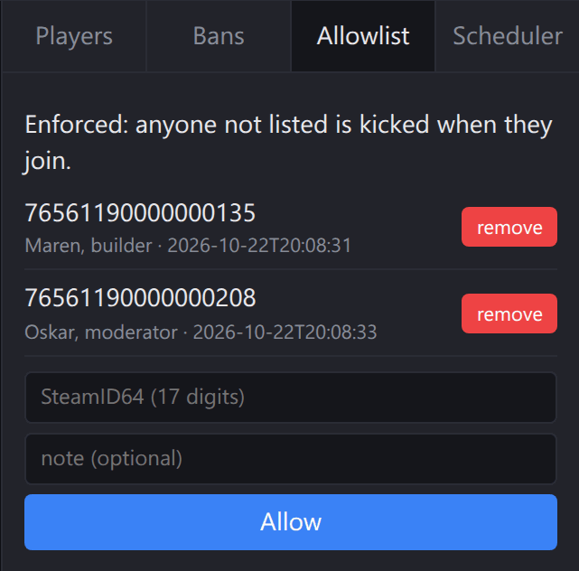
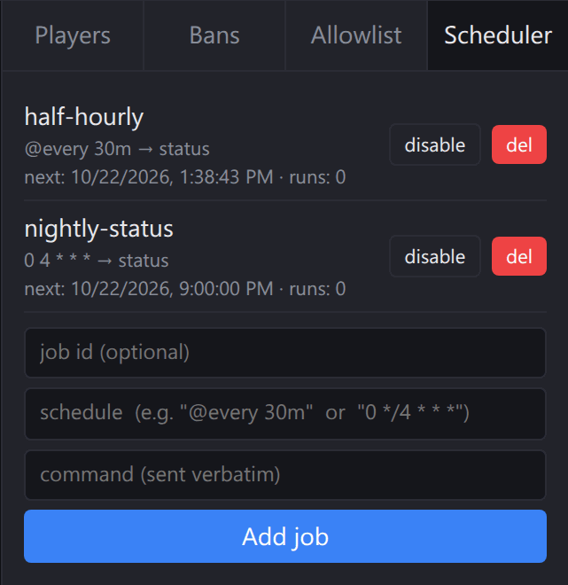
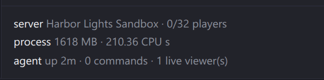

<p align="center">
  
</p>

# SboxServerConsole

[](LICENSE)
[](https://dotnet.microsoft.com/)
[](#install)
[](https://developer.valvesoftware.com/wiki/Source_RCON_Protocol)
[](https://store.steampowered.com/app/590830/)

The s&box dedicated server has no RCON and no web console. SboxServerConsole adds them, plus bans and a whitelist that kick on join, scheduled commands, crash restarts, an audit log and Discord alerts. It's one program that runs next to the server on Windows or Linux, and it changes nothing in s&box or your game.

_SboxServerConsole is a community project and is not affiliated with or endorsed by Facepunch Studios._

> [SurvivalServers.com](https://www.survivalservers.com/services/game_servers/sbox/?utm_source=github&utm_medium=readme&utm_campaign=sbox_server_console) runs s&box servers with SboxServerConsole installed.

---

## Table of contents

- [Features](#features)
- [Install](#install)
- [Usage](#usage)
- [Ports and security](#ports-and-security)
- [Trust and first run](#trust-and-first-run)
- [Getting help](#getting-help)
- [Contributing](#contributing)
- [License](#license)

---

## Features

### 🖥️ Live web console

Open the dashboard in a browser to watch the server's console live, type commands, kick or ban online players, and manage bans, the whitelist and scheduled commands. It also shows the server's memory, CPU and player count. It's built into the program and needs no internet access.

<p align="center">
  
</p>

### 🚫 Bans and whitelist

SboxServerConsole kicks a banned player the moment they connect. With players on the whitelist, only they can join. With an empty whitelist, anyone can. Adding the first player doesn't kick anyone already on the server, so kick them from the Players tab if they should go. Both lists are saved as JSON files and kept across restarts. A list file that can't be read is set aside, never overwritten.

The s&box dedicated server ignores `+maxplayers`. Set `max-players` instead, and a player who joins a full server is kicked with the message "Server is full."

<p align="center">
  
  
</p>

### ⏰ Scheduled commands

Run any console command on a timer (`@every 30m`) or on a cron schedule (`0 4 * * *`, in UTC). Jobs are saved to disk and keep running across restarts.

<p align="center">
  
</p>

### 📊 Server status

See the server's name, player count and player list, its memory and CPU time, and who joined with their SteamIDs. If the server reports players but SboxServerConsole hasn't seen anyone join, the console says so, because bans can't see joins then either.

<p align="center">
  
</p>

### Also built in

- **Source RCON:** the s&box dedicated server has no RCON. SboxServerConsole adds a standard Source RCON port, so any Source RCON client, such as [mcrcon](https://github.com/Tiiffi/mcrcon) or [rcon-cli](https://github.com/itzg/rcon-cli), can run console commands and read the replies.
- **Crash restarts:** if the server crashes, SboxServerConsole starts it again after a short wait. A server that keeps crashing at start is left stopped after a set number of tries, and SboxServerConsole exits with code 4 so systemd or a Windows service can take over. Restarts you ask for don't count.
- **Audit log and Discord alerts:** every command, RCON login, ban change, scheduled run and restart is written to an audit log, with a new file every 10 MB. Add a Discord webhook to post joins, leaves, starts and crashes to your channel.
- **HTTP API:** everything the dashboard does is an HTTP call with JSON in and out, including a live console feed (Server-Sent Events) that picks up where it left off after a reconnect. Reference: [`docs/api.md`](docs/api.md).

---

## Install

You need an s&box dedicated server. Install it with [SteamCMD](https://developer.valvesoftware.com/wiki/SteamCMD) (app `1892930`, no Steam login needed):

```bash
# Windows
steamcmd +force_install_dir "C:\sbox-server" +login anonymous +app_update 1892930 validate +quit

# Linux
./steamcmd.sh +force_install_dir /opt/sbox-server +login anonymous +app_update 1892930 validate +quit
```

The server's command line goes in `child-args`. SboxServerConsole splits it into arguments itself: double quotes group words (`+hostname "My Server"`) and every other character reaches the server as written. SboxServerConsole reads `+port` (the game port) and `+net_query_port` (the A2S port, 27016 if you leave it out). `+game <package> [map]` picks what to run, `+net_game_server_token <token>` gives the server a fixed SteamID ([register one](https://steamcommunity.com/dev/managegameservers) with app ID `1892930`), and `+sv_password <password>` adds password protection (s&box 26.10.27 and later). Facepunch's [dedicated server guide](https://sbox.game/dev/doc/networking/dedicated-servers) lists the rest.

### Windows (x64)

1. Download `SboxServerConsole.exe` from the [latest release](https://github.com/HumanGenome/SboxServerConsole/releases/latest) and put it next to `sbox-server.exe`.
2. Copy [`examples/config.example.json`](examples/config.example.json) to `config.json` and set the paths and a strong `rcon-password`.
3. Run it:

   ```powershell
   .\SboxServerConsole.exe --config-file .\config.json
   ```

4. Optional: install it as a Windows service with automatic restart (run as Administrator):

   ```powershell
   .\scripts\install-service.ps1 -ExePath .\SboxServerConsole.exe -ConfigPath .\config.json
   Start-Service SboxServerConsole
   ```

   `SboxServerConsole-win-x64.zip` on the release page has the scripts and examples with the exe.

### Linux (x64)

1. Download and unpack the release next to the server:

   ```bash
   cd /opt/sbox-server
   curl -L -o sboxconsole.tar.gz https://github.com/HumanGenome/SboxServerConsole/releases/latest/download/SboxServerConsole-linux-x64.tar.gz
   tar -xzf sboxconsole.tar.gz
   ```

2. Copy [`examples/config.linux.example.json`](examples/config.linux.example.json) to `sboxconsole.json` and set the paths and a strong `rcon-password`. `exe` points at the server's own `sbox-server` program.
3. Run it:

   ```bash
   ./SboxServerConsole --config-file ./sboxconsole.json
   ```

4. Optional: run it under systemd with the example unit. Edit `User=`, `ExecStart=`, `WorkingDirectory=` and `ReadWritePaths=` first.

   ```bash
   sudo install -d /var/log/sboxconsole /var/lib/sboxconsole
   sudo cp examples/sboxserverconsole.service /etc/systemd/system/
   sudo systemctl daemon-reload
   sudo systemctl enable --now sboxserverconsole
   ```

**On Linux, use 1.4.0 or later.** Older releases can't send commands, kicks or bans to current s&box servers.

### Settings

Every `--flag` also works as a key in the JSON config file, and flags on the command line win. Run `SboxServerConsole --help` for the full list. A setting it doesn't know, such as a misspelled key, gets a warning at startup.

---

## Usage

- **Dashboard:** open `http://127.0.0.1:<listen-port>/` (the game port + 4 by default) and enter the RCON password. Use `127.0.0.1`, not `localhost`. The dashboard answers only on the address it's set to.
- **RCON:** connect any Source RCON client to the game port + 5, for example `mcrcon -H your-host -P 27020 -p YourPassword "status"`.
- **Terminal:** when you start SboxServerConsole in a terminal, the same window shows the server's console and takes commands.
- **Scripts:** see [`examples/curl.sh`](examples/curl.sh) for curl examples and [`examples/python_client.py`](examples/python_client.py) for a small Python client.

```bash
# Run a command and get its output
curl -X POST "http://127.0.0.1:27019/execute?collect=1" \
  -H "X-RCON-Password: YourPassword" -d '{"cmd":"status"}'
```

`POST /server/start`, `/server/stop` and `/server/restart` start and stop the game server while SboxServerConsole keeps running. On Windows, send them with `Content-Length: 0` or a `{}` body, or Windows answers `411 Length Required`. `POST /chat` sends a chat message with the game's `say` command. Many games have no `say`, the unmodded `facepunch.sandbox` included, and the API answers `422` on those.

---

## Ports and security

| Port (defaults for game port 27015) | Protocol | Used for |
|---|---|---|
| 27015 | UDP | Game traffic (`+port`). With the server's default `net_hide_address` on, players come in through Steam's relay by the server's SteamID and nothing listens on this port |
| 27016 | UDP | A2S query (`+net_query_port`, or 27016 when not set) |
| 27019 | TCP | HTTP API, dashboard and live console (game port + 4) |
| 27020 | TCP | Source RCON (game port + 5) |

- Both ports answer only on `127.0.0.1` by default. To reach them from other computers, set `--bind 0.0.0.0` and open the firewall. SboxServerConsole has no HTTPS of its own, so put a reverse proxy in front for that. Have the proxy send `127.0.0.1:<port>` as the Host header (nginx does this by default. In Caddy, use `header_up Host {upstream_hostport}`).
- One password, `--rcon-password`, protects the HTTP API and RCON. Without one, the API answers `503` and RCON stays off.
- After 10 wrong passwords in a minute, that address is locked out of both for 5 minutes. Local connections are never locked out.
- Commands with line breaks or control characters are refused, and the log browser never serves hidden files or dot-files, which keeps the agent's own config out of reach.

Report security problems privately, as described in [SECURITY.md](.github/SECURITY.md).

---

## Trust and first run

On first run, Windows may show "Windows protected your PC". Choose **More info**, then **Run anyway**. If you downloaded the zip in a browser, unblock the file first (`Unblock-File .\SboxServerConsole.exe`). If your company only allows signed programs, build it yourself:

```bash
dotnet publish src/SboxServerConsole.csproj -c Release -r win-x64 --self-contained -p:PublishSingleFile=true -o publish/win-x64
```

A build of your own won't match the release file byte for byte. To check a download, compare it with `SHA256SUMS` on the release page.

---

## Getting help

- **Bugs and feature requests:** [GitHub issues](https://github.com/HumanGenome/SboxServerConsole/issues). Include your SboxServerConsole version (`GET /version`), the server build (first line of `.version` in the server folder) and SboxServerConsole's console output.
- **Problems with the s&box server itself:** [Facepunch's issue tracker](https://github.com/Facepunch/sbox-public/issues).
- **A server you rent:** ask your host.

## Contributing

Pull requests are welcome. [CONTRIBUTING.md](CONTRIBUTING.md) has the build and test commands.

## License

MIT, see [LICENSE](LICENSE). The .NET runtime and Cronos are built into the program. Their licence notices are in [THIRD-PARTY-NOTICES.txt](THIRD-PARTY-NOTICES.txt), which both release archives carry.
